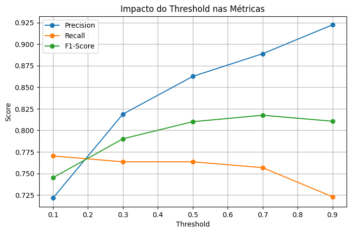
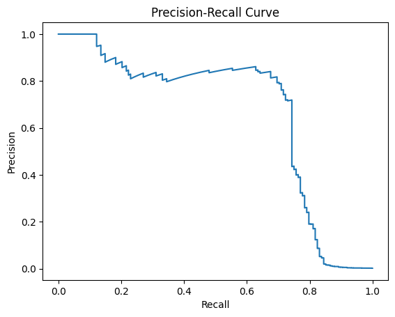
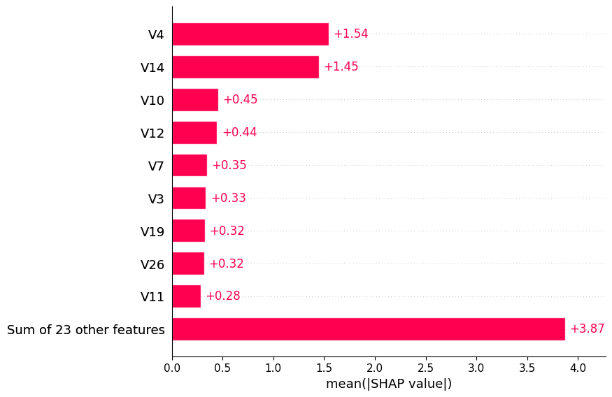

# Credit Card Fraud Detection

[](https://colab.research.google.com/github/ranabarbara1/fraud-detection-transactions/blob/main/Projeto__Detec%C3%A7%C3%A3o_de_Anomalias_em_Transa%C3%A7%C3%B5es_em_Python.ipynb)

Binary classification of fraudulent card transactions on a highly imbalanced dataset (0.17% fraud). The project compares Logistic Regression, Random Forest and XGBoost, tunes the decision threshold for the business trade-off between missed fraud and false alerts, and explains the model with SHAP.

> Notebook written in Portuguese. This README summarises it in English.

## Dataset

- **Credit Card Fraud Detection** (European cardholders, September 2013), originally published by the Machine Learning Group of ULB and widely available on Kaggle. The notebook loads a public mirror hosted by TensorFlow.
- 284,807 transactions, of which **0.17% are fraud**.
- Features `V1` to `V28` are PCA components (anonymised). `Time` and `Amount` are raw.
- Split: 70% train / 30% test, stratified by class (test set: 85,443 transactions, 148 frauds).

## Approach

1. **Imbalance diagnosis**: accuracy is misleading here (a model that predicts "no fraud" for everything scores 99.8%), so the evaluation focuses on **precision, recall, F1** and the **precision-recall curve**.
2. **Feature engineering**: log transform and standardisation of `Amount`.
3. **Handling imbalance**: class weighting (`class_weight="balanced"` in Random Forest, `scale_pos_weight` in XGBoost). Undersampling and SMOTE were also explored.
4. **Models**: Logistic Regression (baseline), Random Forest, XGBoost.
5. **Hyperparameter search**: `GridSearchCV` on XGBoost, optimising recall with 3-fold cross-validation.
6. **Threshold analysis**: precision, recall and F1 for thresholds from 0.1 to 0.9.
7. **Explainability**: XGBoost feature importance and SHAP values.

## Results (fraud class, test set)

| Model | Threshold | Precision | Recall | F1 |
|---|---|---|---|---|
| Logistic Regression | 0.5 | 0.84 | 0.66 | 0.73 |
| Logistic Regression | 0.3 | 0.79 | 0.71 | 0.75 |
| Random Forest (balanced) | 0.5 | 0.84 | 0.76 | 0.79 |
| **XGBoost** (`scale_pos_weight=10`) | 0.5 | **0.93** | **0.78** | **0.85** |
| XGBoost tuned (`max_depth=3`, `n_estimators=100`) | 0.5 | 0.86 | 0.76 | 0.81 |
| XGBoost tuned | 0.7 | 0.89 | 0.76 | 0.82 |

Logistic Regression ROC-AUC: 0.927.

**Business reading (tuned XGBoost, threshold 0.7):** 112 of the 148 frauds in the test set were detected (75.7%), and 36 were missed. Lower thresholds raise recall at the cost of more false alerts; higher thresholds do the opposite. The right point depends on the cost of a missed fraud versus the cost of investigating a false alert.



| Precision-recall curve (Logistic Regression) | SHAP feature importance (XGBoost) |
|---|---|
|  |  |

## Limitations and next steps

Kept here on purpose: they are the improvements a production version would need.

- **Threshold chosen on the test set.** It should be selected on a separate validation set (or with cross-validation) to avoid an optimistic estimate.
- **Scaling fitted before the split** (`Amount_scaled`), a small leakage. Moving it into a `Pipeline` fixes it.
- **Grid search optimised recall only**, and the tuned model ended with a lower F1 than the default XGBoost. Next step: optimise average precision (PR-AUC) or F1 over a wider grid.
- **Resampling not compared end to end.** SMOTE and undersampling were prepared but the reported models use class weighting. A fair comparison would apply SMOTE inside the cross-validation folds only.
- **Report PR-AUC** for every model, which is more informative than ROC-AUC with 0.17% positives.

## How to run

Open the notebook in Colab with the badge above, or locally:

```bash
python -m venv .venv
source .venv/bin/activate        # Windows: .venv\Scripts\activate
pip install -r requirements.txt
jupyter notebook
```

The dataset is downloaded automatically by the first cells (about 150 MB).

## Stack

Python · pandas · NumPy · scikit-learn · imbalanced-learn · XGBoost · SHAP · Matplotlib
